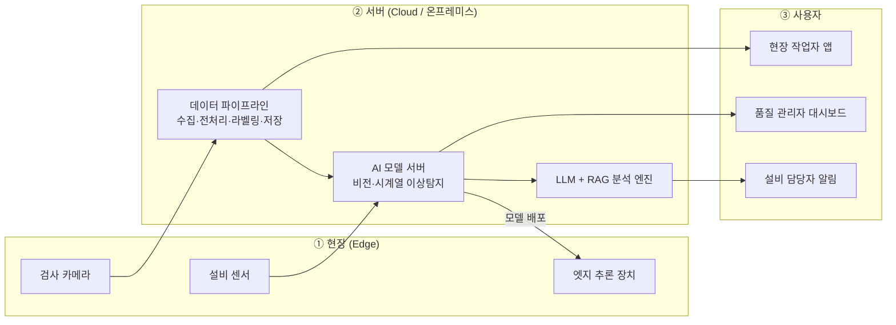

# QualiMate (퀄리메이트)

> **중소 제조현장을 위한 AI 품질·설비 통합 관리 서비스**
> AI Smart Factory 도메인 서비스 기획 | 코디세이 AI 올인원 · 입학연수 Term Project (7개 도메인 아이디어톤)

QualiMate는 제품 이미지와 설비 센서 데이터를 AI로 분석해 **불량과 설비 이상을 찾아내고, 원인과 조치 방법까지 안내**하는 중소 제조기업용 서비스입니다. 검사 결과를 알려주는 도구를 넘어, 다음에 무엇을 해야 하는지 알려주는 동료(mate)를 지향합니다.

---

## 📌 프로젝트 정보

| 항목 | 내용 |
|------|------|
| 팀명 | [팀명 입력] |
| 도메인 | AI Smart Factory |
| 팀원 | [팀원 A] · [팀원 B] · [팀원 C] · [팀원 D] · [팀원 E] |
| 과제 | 7개 도메인 아이디어톤 (Term Project, 팀 단위 AI 서비스 기획) |
| 제출 | 4주차 목요일 13:00 |

## 📂 저장소 구성

```text
.
├── README.md                  # 프로젝트 소개 (이 문서)
└── docs/
    ├── QualiMate_서비스기획서.pdf   # 서비스 기획서
    └── QualiMate_발표자료.pdf       # 발표 자료
```

> 기획서 원본(Word)과 발표자료 원본(PPT)이 있다면 `docs/`에 함께 올려 주세요.

---

## 1. 문제 정의

### 1.1 배경

- **스마트공장은 늘었지만 AI 활용은 초입 단계입니다.** 보도에 따르면 스마트공장 도입 기업 중 제조 AI를 도입했거나 계획 중인 곳은 **5.2%**, **75.5%**는 여전히 기초 단계에 머물러 있습니다.
- **비용 부담이 중소 제조기업의 큰 장벽입니다.** 정부도 중소 제조기업 AI 도입률 **10%** 달성을 목표로 제시했습니다.
- **현장의 품질·설비 관리는 여전히 사람 경험에 크게 의존합니다.** 외관 검사는 숙련도와 피로도에 따라 편차가 생기고, 설비 고장은 발생한 뒤에 대응하는 경우가 많아 라인 정지로 이어집니다.

> ※ 수치는 언론 보도 기준이며 [참고 자료](#9-참고-자료)에서 확인할 수 있습니다.

### 1.2 해결하고자 하는 문제

| 문제 | 현장의 현상 | AI 해결 방향 |
|------|-------------|--------------|
| ① 불량 검출 편차 | 육안 검사는 숙련도·피로에 따라 판정이 달라지고 미세 불량을 놓치기 쉽다 | 비전 AI가 일관된 기준으로 24시간 검사하고 불량 의심 영역을 표시 |
| ② 데이터·인력 부족 | 불량 샘플이 적고 AI 전담 인력이 없어 기존 AI 솔루션을 쓰기 어렵다 | 정상 이미지 위주로 학습하는 이상탐지와 노코드 UI로 진입장벽 완화 |
| ③ 사후 중심 설비관리 | 고장 후 수리하는 방식이라 예기치 못한 라인 정지가 발생한다 | 센서 시계열에서 이상 징후를 조기 탐지해 점검 시점 제안 |
| ④ 원인 분석 지연 | 작업표준서·불량 이력·조치 기록이 흩어져 있어 원인 파악이 느리다 | LLM+RAG가 문서와 이력에서 유사 사례와 조치 방안을 안내 |

### 1.3 주제 선택 이유

- 중소 제조기업 AI 전환이 정책적으로도 추진되고 있어 문제의 시의성과 필요성이 분명합니다.
- 컴퓨터 비전, 시계열 분석, LLM 등 학습 과정에서 다루는 AI 기술을 한 서비스 안에서 폭넓게 적용할 수 있습니다.
- MVTec AD, CWRU 베어링 진동 데이터 같은 공개 데이터셋으로 프로토타입을 검증할 수 있어 실현 가능성이 높습니다.

---

## 2. 타겟 사용자

- **주 타겟:** 스마트공장 기초 단계에 있는 중소 제조기업(금속·기계 가공, 전자부품, 조립 등 외관 검사 비중이 높은 업종)의 품질관리 담당자, 현장 작업자, 설비 담당자
- **부 타겟:** 스마트공장 공급기업·시스템 통합(SI) 업체, 소공인 사업장

| 사용자 | 겪는 어려움 | 핵심 니즈 | 서비스 대응 |
|--------|-------------|-----------|-------------|
| 품질관리 담당자 | 불량 유출 책임은 큰데 검사 인력·시간은 부족하고 리포트를 수작업으로 만든다 | 불량을 놓치지 않는 일관된 검사, 자동 리포트 | AI 외관 검사 + 자동 품질 리포트 |
| 현장 작업자 | 불량이 나도 원인과 조치법을 숙련자에게 물어봐야 한다 | 즉시 따라 할 수 있는 조치 가이드 | AI 원인·조치 도우미 (모바일 앱) |
| 설비 담당자 | 고장 징후를 알기 어렵고 점검이 사후 대응에 끌려간다 | 고장 전 알림, 점검 우선순위 | 설비 이상 조기 경보 |

---

## 3. 서비스 개요

### 3.1 핵심 기능

| 기능 | 설명 |
|------|------|
| **F1. AI 외관 검사** | 정상 제품 이미지 수십~수백 장으로 학습을 시작하고, 불량 의심 영역을 히트맵으로 표시. 불량 라벨이 쌓이면 유형 분류까지 확장 |
| **F2. 설비 이상 조기 경보** | 진동·온도·전류 센서의 시계열을 분석해 이상 점수를 산출하고 임계치 초과 전에 점검을 권고 |
| **F3. AI 원인·조치 도우미** | 작업표준서와 과거 이력에서 유사 사례를 검색해 원인 후보와 조치 방법을 제안하고 근거 문서를 함께 표시 |
| **F4. 자동 품질 리포트** | 일·주간 불량률, 불량 유형 분포, 설비 상태를 자동 요약해 관리자에게 전달 |

### 3.2 기존 서비스 대비 차별점

| 비교 항목 | 기존 스마트공장(MES 등) | 기존 머신비전 솔루션 | **QualiMate** |
|-----------|-------------------------|----------------------|---------------|
| 핵심 역할 | 생산 기록·모니터링 | 고정 규칙 기반 검사 | **예측·판단·조치 안내** |
| 필요 데이터 | 수기·시스템 입력 | 대량의 불량 이미지 | **정상 이미지 위주로 시작** |
| 도입 난이도 | 구축 프로젝트 필요 | 전문가 세팅 필요 | **노코드 UI로 셀프 세팅(목표)** |
| 품질·설비 연계 | 분리 운영 | 검사만 수행 | **품질·설비 데이터 통합 분석** |
| 비용 구조 | 구축비 중심 | 장비·세팅 비용 높음 | **구독형 저비용(목표)** |

> ※ 일반적인 특성 기준 비교이며 특정 제품을 지칭하지 않습니다.

### 3.3 사용자 시나리오

1. 라인 카메라가 제품을 촬영하면 엣지 장치가 즉시 정상/이상을 판정합니다.
2. 이상 판정 시 불량 의심 위치가 표시되고 작업자 앱으로 알림이 전송됩니다.
3. 작업자가 '원인·조치 도우미'를 열면 유사 불량 사례와 조치 방법이 근거 문서와 함께 표시됩니다.
4. 같은 시간대 설비 센서에 이상 징후가 있었다면 설비 담당자에게 점검 알림이 함께 전달됩니다.
5. 관리자는 주간 리포트로 불량 추이와 개선 효과를 확인합니다.

---

## 4. AI 기술 적용 방안

### 4.1 적용 기술과 선택 이유

| 기능 | 적용 기술 | 입력 데이터 | 선택 이유 |
|------|-----------|-------------|-----------|
| 외관 검사 | PatchCore·PaDiM 계열 비지도 이상탐지 (고도화: YOLO 계열 검출·분류) | 제품 이미지 | 불량 샘플이 적어도 정상 데이터만으로 학습할 수 있고, 이상 위치를 히트맵으로 설명할 수 있다 |
| 설비 이상 탐지 | Isolation Forest(기준 모델) → LSTM Autoencoder | 진동·온도·전류 시계열 | 라벨이 없는 데이터에서도 이상 징후를 찾을 수 있고, 단순한 모델부터 단계적으로 고도화할 수 있다 |
| 원인·조치 도우미 | LLM + RAG (문서 임베딩, 벡터 검색) | 작업표준서, 불량 이력, 점검 기록 | 사내 문서에 근거해 답하고 출처를 표시해 환각 위험을 줄인다 |
| 엣지 추론 | ONNX·TensorRT 모델 경량화 | - | 현장 실시간 판정이 가능하고 네트워크 지연과 데이터 외부 전송 부담이 줄어든다 |

### 4.2 성능 평가 지표와 검증 계획

- **외관 검사:** Image AUROC, 재현율(Recall, 불량을 놓치지 않는 것을 우선), 오탐률
- **설비 이상 탐지:** 경보 선행 시간, 오경보율
- **원인·조치 도우미:** 근거 문서 일치율, 응답 시간
- **검증 데이터:** 프로토타입 단계에서 공개 데이터셋(예: MVTec AD, CWRU 베어링 진동 데이터)으로 검증하고, 이후 협력 사업장 데이터로 재검증

### 4.3 유의 사항

- AI 판정은 보조 수단이며 **최종 판단과 출하 결정은 사람이 하는 구조(Human-in-the-loop)** 로 설계합니다.
- 제조 데이터는 민감 정보이므로 엣지·온프레미스 배포 옵션을 제공하고 접근 권한을 분리합니다.

---

## 5. 시스템 구성



- **현장(Edge):** 검사 카메라와 설비 센서가 데이터를 수집하고, 엣지 장치가 경량화된 모델로 실시간 판정
- **서버:** 데이터 파이프라인(수집·전처리·저장), AI 모델 서버(학습·재학습·모델 배포), LLM+RAG 엔진(원인·조치 분석)
- **사용자:** 작업자 앱, 품질 관리자 대시보드, 설비 담당자 알림으로 결과 전달
- **예상 기술 스택:** Python·PyTorch(모델), FastAPI(API 서버), PostgreSQL·시계열 DB(저장), 벡터 DB(문서 검색), 웹 대시보드, Docker(배포)

---

## 6. 기대 효과

| 관점 | 기대 효과 |
|------|-----------|
| 사용자 | 검사 품질의 일관성 확보와 불량 유출 위험 감소 · 원인 파악·조치 시간 단축, 숙련자 의존도 완화 · 고장 전 점검으로 라인 정지 감소 · 보고서 작성 등 반복 업무 자동화 |
| 비즈니스 | 구독형 모델로 초기 투자 부담 완화 · 공급기업 파트너십을 통한 확산 경로 확보 · 데이터 축적에 따른 업종별 특화 모델 고도화 |
| 사회 | 중소 제조기업 AI 도입률 제고에 기여 · 현장 작업자의 반복 검사 부담과 안전 위험 완화 |

**프로토타입 목표 지표 (가정치)**

| 지표 | 목표 | 검증 방법 |
|------|------|-----------|
| 외관 이상탐지 AUROC | 0.95 이상 | MVTec AD 일부 카테고리 |
| 불량 재현율 / 오탐률 | 95% 이상 / 5% 이하 | 검증 세트 평가 |
| 엣지 판정 시간 | 이미지 1장당 1초 이내 | 엣지 환경 측정 |

> ※ 팀이 설정한 프로토타입 수준의 가정치이며, 실제 현장 성과를 보장하는 수치가 아닙니다.

---

## 7. 향후 발전 방향

| 단계 | 기간(안) | 목표와 주요 내용 |
|------|----------|------------------|
| 1단계 프로토타입 | 0~3개월 | 공개 데이터셋 기반 외관 검사·설비 이상탐지 모델 구현, 대시보드와 작업자 앱 시연 버전 완성 |
| 2단계 파일럿 | 3~9개월 | 협력 중소기업 1~2곳 단일 라인 설치, 현장 데이터로 재학습, 오탐·미탐 피드백 반영 |
| 3단계 확장 | 9~18개월 | 다공정·다품종 확장, MES/ERP 연동, 업종별 템플릿과 구독 요금제 출시 |
| 4단계 고도화 | 18개월~ | 불량 원인 자동 추론, 공정 파라미터 추천, 공급기업 채널 제휴로 확산 |

---

## 8. 팀 역할 분담

| 역할 | 담당자 | 담당 영역 | 기여 내용 |
|------|--------|-----------|-----------|
| 팀장 · 기획 총괄 | [팀원 A] | 전체 일정·산출물 관리, 문제 정의 | 기획서 통합 편집, 회의 진행, 최종 발표 |
| 시장·사용자 조사 | [팀원 B] | 산업 현황, 타겟 사용자, 경쟁 서비스 | 현황 조사, 사용자 니즈 분석, 기대 효과 정리 |
| AI 설계(비전) | [팀원 C] | 외관 검사 모델, 평가 지표 | 이상탐지 기술 조사·선정, 검증 계획 수립 |
| AI 설계(시계열·LLM) | [팀원 D] | 설비 이상탐지, LLM+RAG | 기술 선택 근거 정리, 원인·조치 도우미 설계 |
| 시스템·발표 자료 | [팀원 E] | 아키텍처, UI 구성, 발표 PPT | 구성도 작성, 화면 시안, 발표 자료 제작 |

---

## 9. 참고 자료

- 머니투데이, 「제조 中企 전반에 인공지능 입힌다…AI도입률 10% 달성 목표」, 2025.10.24. <https://www.mt.co.kr/economy/2025/10/24/2025102415433311872>
- 비즈한국, 「ai adoption slow for manufacturers」. <https://bizhankook.com/articles/ai-adoption-slow-for-manufacturers.html>
- 헤럴드경제, 「중기부 'AI 기반 스마트제조혁신 3.0'」. <https://biz.heraldcorp.com/article/10600333>
- 공개 데이터셋: MVTec AD, CWRU Bearing Data Center (프로토타입 검증용)
